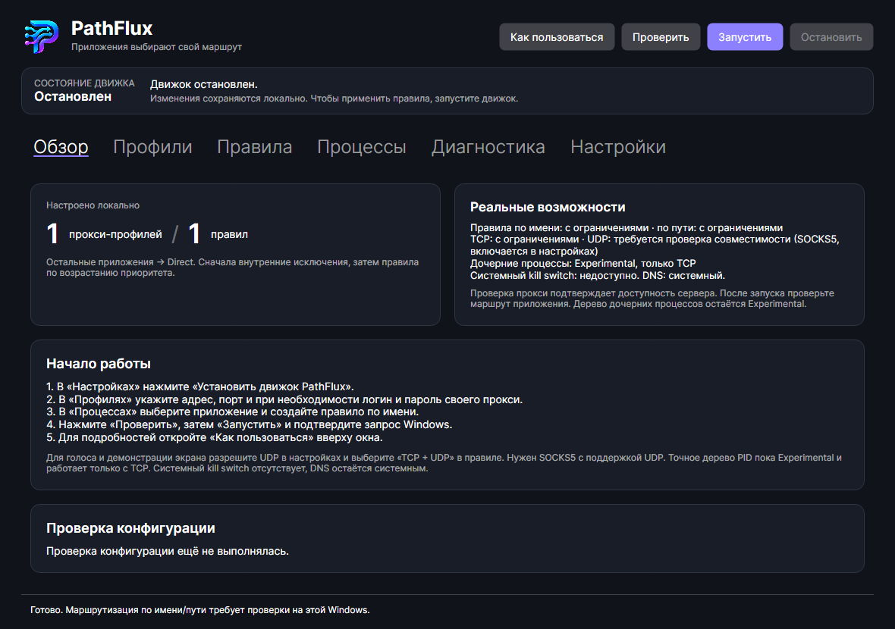

# PathFlux

Windows 10/11 x64 desktop-клиент выборочного проксирования на C# / .NET 10 / Avalonia. Реализованы формы профилей и правил, процессы, DPAPI, атомарный JSON, TCP-диагностика, проверка UDP echo через SOCKS5 relay, компилятор sing-box и отдельный агент с UAC.

**Состояние: инженерный MVP; выборочный TCP подтверждён на Windows 11 через настоящий TUN и UAC-агент, включая Docker SOCKS5/OpenVPN.** UDP SOCKS5 доступен как Experimental с ручным opt-in через обычное приложение. Длительные Discord Voice / Go Live ещё не приняты. Один успешный check или HTTPS-ответ не подтверждает выбранный маршрут. Точный PID и системный kill switch недоступны. Полная [матрица возможностей](docs/limitations.md).

Строгий UDP-транспорт интегрирован в production-агент: отклонение SOCKS-фрагментов, восстановление ассоциаций и явный Docker NAT с динамическим портом релея. По умолчанию UDP выключен, миграция старых настроек его не включает. [Включение, архитектура и результаты этапа 3](docs/udp-production-stage3.md), [сценарий Discord на 30/60 минут](docs/discord-acceptance.md), [ограничения DNS/WFP](docs/dns-wfp-stage3.md).

Включение или отключение стороннего VPN не требует возвращать всю сеть к старому состоянию для остановки PathFlux. Собственные ресурсы проверяются отдельно; при изменении общей сети исходный снимок сохраняется как неподтверждённый архив. [Остановка и переходы VPN](docs/vpn-transition-recovery.md).



## Сборка и запуск

Требуется Windows x64 и .NET SDK 10.0.401 (закреплён в global.json).

```powershell
dotnet restore PathFlux.slnx
dotnet build PathFlux.slnx -c Release
dotnet test PathFlux.slnx -c Release --no-build
dotnet run --project PathFlux/PathFlux.csproj -c Release --no-build
```

UI запускается с обычными правами. Сборка автоматически кладёт агент в `agent/` рядом с приложением. Только кнопка запуска движка вызывает UAC для отдельного агента. Для portable-папки: `./scripts/publish.ps1`; требуется .NET Runtime 10 x64.

## Первая настройка

1. Выполнить `./scripts/get-engine.ps1`: скрипт получает **официальный sing-box 1.14.3 Windows amd64**. Можно выбрать другой стабильный выпуск от 1.12.2: `./scripts/get-engine.ps1 -Version 1.12.2`. SHA-256 архива сверяется с официальными метаданными GitHub. Бинарник не включён в Git и publish.
2. В «Настройки» указать полный `EnginePath` и `EngineSha256`, возвращённые скриптом. При замене EXE обновить оба значения. Приложение и агент проверяют хеш, версию ≥ 1.12.2, платформу Windows x64 и результат `sing-box check`. [Совместимость версий](docs/engine-compatibility.md).
3. В «Прокси» добавить свой SOCKS5 или HTTP/HTTPS CONNECT. `127.0.0.1:1080` — только пример; приложение не устанавливает и не перенастраивает OpenVPN/Docker.
4. В «Диагностика» проверить TCP CONNECT к выбранной цели. UDP ASSOCIATE проверяет только согласование. Для проверки передачи пакетов запустить [подконтрольный UDP echo-сервер](docs/udp-diagnostics.md), указать его IP/порт и нажать «Проверить UDP echo». Сохраняются число пакетов, задержка и время проверки; положительный результат актуален 15 минут и относится только к relay. Изменение адреса/авторизации профиля требует нового теста.
5. В «Процессы» выбрать процессы и создать постоянное TCP-правило по имени/пути. Либо создать правило вручную. Меньший приоритет применяется первым, UUID разрешает равенства.
6. Проверить конфигурацию и запустить агент. TUN затрагивает системные маршруты; сначала ознакомиться с [сетевой проверкой и recovery](docs/network-design.md). Статус Degraded сохраняется из-за ограничений UDP/PID/DNS и неполной матрицы сетевой приёмки.

Профили и правила хранятся в `%LOCALAPPDATA%/PathFlux/config.json`; пароли — в отдельном DPAPI-хранилище этого пользователя. Изменение настроек во время работы запрещено: остановить → сохранить → запустить. Необработанная конфигурация движка и его stderr с возможными секретами на диск не пишутся.

## Документация

- [Архитектура](docs/architecture.md), [решение по движку и зависимости](docs/adr-001-engine.md).
- [Команды разработки и проверки](docs/development.md).
- [Сеть и ручной acceptance](docs/network-design.md), [план PID/WFP](docs/adr-002-process-instance-attribution.md).
- [Проверка UDP relay](docs/udp-diagnostics.md), [результаты второй итерации](docs/verification-udp.md).
- [Изолированный TCP TUN-стенд](docs/tun-lab.md), [результаты его проверки](docs/verification-tun-lab.md).
- [Версии движка от 1.12.2](docs/engine-compatibility.md), [результаты совместимости](docs/verification-engine-versions.md).
- [Ошибки запуска и проверка связи с агентом через UAC](docs/agent-startup.md).
- [Технический аудит TCP/TUN, Docker/OpenVPN и экспериментального UDP](docs/network-audit-2026-10-24.md).
- [Безопасность](docs/security.md), [ограничения](docs/limitations.md), [этапы](docs/milestones.md).

Исходный код PathFlux: MIT. sing-box распространяется отдельно по его собственной лицензии; [условия и источники зависимостей](docs/adr-001-engine.md). Автообновлений, телеметрии и облачной регистрации нет.
